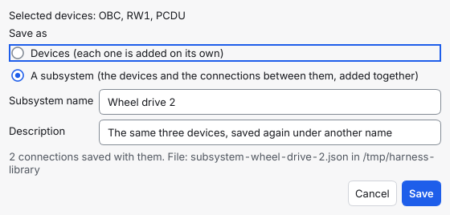

# Use the library

This page shows how a team keeps its devices and subsystems in a **library**: a folder of files that everyone reaches. It shows how to save a device or a subsystem to it, how to add one to a project, and how to say how many of a device a project has. Since 2.2.0 a project can also name its **device libraries**: a device added from one keeps a record of its file, so the program can say when the library has a newer version, and take it when you ask.

> **New in 1.8.0, extended in 2.2.0.** The library window is milestone M4 of the workshop feedback (decision D-175); the device library of a project is decision D-240 (2.2.0, not released yet). The steps in the app are described from the program's code and its tests, and the two pictures are of the real window started without a screen; nobody has watched the steps on a real screen yet (GUI, not run). The command lines were run, and their output is real. The [worked example](#a-worked-example-on-the-command-line) is the end-to-end test of 2.2.0 (`tests/test_e2e_device_library.py`).

## Contents

- [When to use the library](#when-to-use-the-library)
- [What a device library is](#what-a-device-library-is)
- [Before you start](#before-you-start)
- [1. Choose the library folder](#1-choose-the-library-folder)
- [2. Save devices or a subsystem to the library](#2-save-devices-or-a-subsystem-to-the-library)
- [3. Add a device or a subsystem to a project](#3-add-a-device-or-a-subsystem-to-a-project)
- [4. A number of the same device](#4-a-number-of-the-same-device)
- [5. Set up a device library as a Git repository](#5-set-up-a-device-library-as-a-git-repository)
- [6. Point a project to its device libraries](#6-point-a-project-to-its-device-libraries)
- [7. Add a device from a device library](#7-add-a-device-from-a-device-library)
- [8. Review and update a device](#8-review-and-update-a-device)
- [9. Save a device to a device library](#9-save-a-device-to-a-device-library)
- [A worked example on the command line](#a-worked-example-on-the-command-line)
- [Subsystems on the command line](#subsystems-on-the-command-line)
- [Share the library: a drive or a Git repository](#share-the-library-a-drive-or-a-git-repository)
- [Limits](#limits)
- [What the program never does](#what-the-program-never-does)
- [Common mistakes](#common-mistakes)

## When to use the library

- You define a device once, down to each pin ([define a device](define-a-device.md)), and want to use it in the next project without typing it again.
- A device changes after you used it (a pin gets a function, a spare pin is added), and every project that uses it should hear about it and take the change when it is ready.
- A set of devices always comes together with the same connections (a computer and its reaction wheel, a power chain): you want to add the whole set in one step. That set is a **subsystem** ([concepts](../CONCEPTS.md)).
- Several people work on several projects and want the same devices. The library is a **folder** that all of them point the program at.
- A blank project holds no subsystem. They are in the library, and you add the ones you need.

## What a device library is

A **device library** is a folder of **device files**, one device each, named after the device: `OBC1.device.json` holds the device `OBC1` with its connectors, every pin, and the parts and interface types they name. The folder may also hold the files of 2.1 (several devices in one file) and subsystem files; they are still read.

A project **names** its device libraries in a small file at its root, `device-libraries.json`, with paths relative to the project folder (`../acme-devices`). The file is not part of the design: it is outside undo and the change journal, and a project without it opens and generates as before.

When you add a device from a library, the project keeps an **import record** of the file (`devices:OBC1.device.json` in `imports/records.json`): its SHA-256, the name of the library, the file and the Git commit. That record **links** the device, and its copies (`OBC1-R`, `OBC1-3`), to the library file. With it the program can tell the **state** of the device:

| State | What it means |
|---|---|
| *not in project* | The library has the device; the project does not. |
| *up to date* | The device is as the library has it. |
| *library changed* | The library has a newer version. |
| *changed here* | The project changed the device; the library did not. |
| *same ID, not from the library* | The project has a device of that ID, but it was not added from the library (no record). |
| *source not found* | The record names a file that no library of the project holds now. |
| *in more than one library* | Two libraries of the project hold the ID; neither is used. |

What the library owns and what the project owns:

- **The library owns** the connectors with their pins (signal, fixed, function, contact size, termination, contact part, role, direction), and the device's kind, mass relevance and notes.
- **The project owns** the name, subsystem, zone, side (chain) and place of the device, and on each pin its interface, its lock and an allocated signal. An update never changes them.

## Before you start

- A folder that your team can reach: a Git repository that everyone has cloned (best for a device library), or a shared drive. It may be empty. The program does not copy it, send it or ask a server for it: it only reads the files in it and, when you say so, writes into it. Keeping everybody's copy current is what Git or the drive does ([share the library](#share-the-library-a-drive-or-a-git-repository)).
- To save, you need devices in a project. To add, you need a project that is open and not read-only.

## 1. Choose the library folder

Your **library folder** is a setting of the editor, for you on this computer. It is the place the library window saves to, and the library of a project that names none.

1. Choose **File > Library folder…** (or **Settings > Project > Choose…**) and pick the folder.
2. Another person chooses their own path to the same folder, because a shared drive has another name on every computer. **Clear** on the Settings page stops using it.

The program looks for `.json` files in the folder and in the folders two levels below it (a folder whose name starts with a dot, such as `.git`, and a link are not looked into). A file is a library file if it says so in its `format` field: a **device file** (`harness-device-library`, [define a device](define-a-device.md#use-a-device-in-another-project)) or a **subsystem file** (`harness-subsystem-library`, [`FILE_FORMAT.md`](../FILE_FORMAT.md#subsystem-library-file-m4-not-part-of-a-project)). Every other `.json` file, such as a `package.json`, is left alone.

## 2. Save devices or a subsystem to the library

1. Open the library window: **File > Library…** (Ctrl+Shift+O), or **Library…** on the Home page.
2. In the project, select the devices to save, in the diagram or in the project tree (Ctrl+click for more).
3. Press **Save selection to library…** in the window. It stays off until a library folder is chosen and a device is selected; the tooltip says which.
4. Choose how to save:
   - **Devices**: each device is saved with its connectors and pins, and is added on its own later. Each device goes into the file of the folder that holds it already, else into a file of its own, `<ID>.device.json`; a device with the same ID in that file that is different is never replaced without asking: you choose **Replace**, **Save as** a new ID or **Cancel**, and a part never gets a lower approval than the file has. The list shows the file of each entry. A device that is in two files of the folder is offered from neither, and two device files with the same name are refused; the message names the files.
   - **A subsystem**: the devices **and the connections between them**, added together later. Give it a **Subsystem name** and, if you like, a **Description**. A connection with one end on a device that you did not select is left out (the window says how many). The file is `subsystem-<name>.json`.
5. Press **Save**. The window reads the folder again and the new entry is in the list.




The program never replaces a subsystem file. If the name is taken, the window says so under the fields (*The library has a subsystem file … already. Choose another name, or delete that file if it is out of date.*) and **Save** stays off.

## 3. Add a device or a subsystem to a project

1. Open the library window. Its window is not modal: you can keep working in the editor beside it. It lists the devices and subsystems of the **libraries of this project** (the line under the folder names each, with its path) and of **your library folder**; the **Library** column says where each entry comes from.
2. Look for what you need: type in the search field (words from the name, the ID, the description or the library; every word must be found) and use the filter **Devices and subsystems / Devices / Subsystems**. Press **Refresh** (F5) if a colleague has just added to a library.
3. Choose an entry. The right side shows a preview: the connectors and pins of a device (connector, pin, signal, function), or the devices and the connections of a subsystem.
4. Press **Add to project** (or Enter in the list). One step is added to the project, and **Edit > Undo** takes all of it back.

What the program does when it adds:

- **Nothing in the project is replaced.** In a subsystem, a device whose ID is taken gets the next free one: `OBC` becomes `OBC-2`, its connectors follow (`OBC-2-J01`), and the connections follow too. A note under the list names every renamed ID. For a single device whose ID is taken, the program asks what to do ([section 7](#7-add-a-device-from-a-device-library)).
- **A subsystem is added whole.** Every device gets the subsystem name of the file as its **Subsystem**, the connections between the new connectors are added, and the devices stand side by side in one lane of the diagram. If one device or one connection of the subsystem cannot be added, nothing is added and the window says which one and why.
- **Parts and interface types** that the project does not have are added with the status that the file says; the program does not decide it again. A part that the project has already is kept as the project has it, and a note says if the file's part differs.
- **A project that is read-only** cannot be added to; the button is off and says so.

The Devices tab keeps its two buttons **Save to library…** and **Add from library…**; they work with one file ([define a device](define-a-device.md#use-a-device-in-another-project)). The library window is the place for whole folders.

## 4. A number of the same device

Redundancy is easy to say: how many of this device does the design have? There is no need to choose a nominal chain and a redundant chain first.

- **When you add a device** (**Edit > Add device > Device…**, Ctrl+Shift+N): **Number of these devices**. With 1 you get the device. With 2 you get `STAR1` and `STAR1-R` (named *Star tracker (redundant)*, on the redundant chain). With 3 you also get `STAR1-3` (named *Star tracker (copy 3)*), and so on up to 10. It is one undo step.
- **For a device that is in the project**: in the **Devices** tab, raise **Number of these devices** and press **Add copies**. The copies are made with the connectors of the device, and the links of the device are mirrored onto them where the device at the other end has a free connector of the right type; the links that could not be mirrored are named in the message, as with a redundant copy.
- **From the library**: the same number beside **Add to project** (for a device; a subsystem is added once), or `add-device --count N` on the command line. Copies of a device that follows a library follow it too.

The second device is exactly what **Edit > Create redundant copy** has always made, so a project and its outputs are the same whichever way you did it (`PCDU1-R`, its connectors `PCDU1-R-J01`, links ending in `-R`). The older way stays: **Create redundant copy**, the **Chain** field of a device, and the fix of a link between the two chains ([redundancy and zones](redundancy-and-zones.md)).

The number is not stored anywhere; the program counts the devices that exist (`ID`, `ID-R`, `ID-3` ...). So:

- The number only grows. To have fewer, delete a copy as you delete any device (it is refused while a harness of a release uses it, as always).
- A copy has no number of its own: set the number on the device it was copied from (the field says so).
- If you deleted `ID-3` and ask again for 3, `ID-3` is made again; a gap is filled first.

## 5. Set up a device library as a Git repository

A device library works best as a Git repository of its own: every change is a commit, the record of a project names the commit it took, and a colleague's change arrives with a pull.

1. Make a folder, for example `acme-devices`, and give the library a name in a file `library.json` at its root. The name stays the same in every clone, whatever the folder is called there:

   ```json
   {"format": "harness-device-library-folder", "version": 1, "name": "ACME devices", "description": "The devices of the example team"}
   ```

   Without `library.json`, the library's name is the folder's name.
2. Add a `.gitignore` with the line `*.bak`. When the program replaces a device file, it keeps the old one as a `.bak` file next to it; that copy does not belong in the repository.
3. Save the devices into it ([section 9](#9-save-a-device-to-a-device-library)), then commit: `git init`, `git add -A`, `git commit`. The program never commits and never starts Git; it reads the commit and the branch from the `.git` folder itself.

The rules of the folder, in short (all of them: [`FILE_FORMAT.md`](../FILE_FORMAT.md#device-library-file-140-not-part-of-a-project)): one device per `NAME.device.json`, and `NAME` is the device's ID; a device in two files is offered from neither, and the message names both files; two device files of the same name in two subfolders are refused, because the record names the file. Files are looked for two levels deep.

## 6. Point a project to its device libraries

The project names its libraries in `device-libraries.json`, with paths relative to the project folder and written with `/`. The program writes the file at once, outside undo, and says so. Commit it with the project.

- **In the editor:** **File > Device libraries of this project…** (or **Settings > Project**). Press **Add library…** and pick the folder, or choose a folder in the list and press **Remove**. **File > Save As…** copies the file and rewrites its paths for the new folder.
- **On the command line:** `harness-design-studio libraries DIR --add ../acme-devices` (and `--remove`). `libraries DIR` lists the libraries with their names, their number of devices and their Git commit; `--devices` adds every device with its state.

**Which libraries a project uses**, in this order: on the command line, the folders of `--library FOLDER` (repeatable; for that run they replace the rest); the libraries of `device-libraries.json`; in the editor only, when the project names none, your library folder. The command line never reads your library folder.

## 7. Add a device from a device library

- **In the editor:** the library window (**Add to project**), **Edit > Add device > From library**, **Add here > From library** on the empty diagram, or Ctrl+K and type *Add from library*. In Quick mode the **Add device** window lists the library devices after the kinds.
- **On the command line:** `harness-design-studio add-device DIR NAME… [--count N] [--as ID] [--dry-run]`. NAME is the device ID, or a device name that only one device has.

The device comes with its connectors, its pins, the parts and interface types the project lacks, a place on the diagram and the import record of its file, in one step that **Undo** takes back.

**When the ID is taken,** nothing is changed until you choose:

- **Add copies** of the project's device (`PCDU00-R`, `PCDU00-3` …; `--count`). Copies of a device that follows the library follow it too.
- **Adopt:** link the project's device to the library and take the library's version (`update-device DIR ID --apply --adopt`). The editor offers it only when the device does not follow the library.
- **Add the library's device under another ID** (`--as ID`). That copy does not follow the library and gets no record.

## 8. Review and update a device

When the library has a newer version of a device, the program shows the difference and **changes nothing until you ask**.

**See the state.** The Inspector and the Devices tab show a line such as *From ACME devices, PCDU00.device.json, up to date*. The library window has a **Status** column, and its preview names the source: the library, the Git commit, the file and *not committed* when the file differs from the last commit. When you open a project, the program reads its libraries in the background; when a device has a newer version, a notice says so (*1 device has a newer version in the library: PCDU00.*). On the command line: `libraries DIR --devices`, and `explain DIR DEVICE` names the library file and the record.

**See the difference.** **Review…** on the notice or on the device's line, or **Review changes…** in the library window, opens the review window; on the command line, `update-device DIR [NAME…]`. Both show one row per field (device, connector, pin, field, in this project, in the library, locked by) and what the change touches: interfaces, wires and links on pins that go, and the harnesses to generate again.

**Take it or keep yours.**

- **Take the library's version** (`update-device DIR NAME --apply`, or `--all`). One step that **Undo** takes back, with the new record. The library-owned fields change; the project-owned fields stay (the name, subsystem, zone, chain, place, and the interfaces on the pins). Missing parts and interface types are added. It is all or nothing for a device and its copies: a change that a released harness locks, a pin that a link pairs, or a part of another category or pin count refuses the device, the message names the reason (and the harness: start a new version with `new-version`), and nothing of that device changes.
- **Keep this project's.** Nothing is stored. The device keeps its state, so the line still says that it differs.
- **Save this project's to the library…** writes the project's version into the library file ([section 9](#9-save-a-device-to-a-device-library)).

**In a build.** `update-device DIR --check` ends with exit code 1 while a device that follows a library differs from it, and `imports DIR --check` ends with 1 while a library file differs from its record. Generate, export, verify and the checks never read a library: a project generates the same with or without one.

## 9. Save a device to a device library

- **On the command line:** `harness-design-studio save-device DIR DEVICE [--library FOLDER] [--replace]`. Without `--library`, the device goes to the library of the project that holds it, else to the project's only library.
- **In the editor:** *Save this project's to the library…* in the review window, or **Save selection to library…** in the library window (which writes into your library folder).

The device goes into the file that holds it already, else into `<ID>.device.json` at the root of the library. A different device of the same ID is refused unless you say `--replace` (in the editor: **Replace**). The project then gets the record of the written file, so the device follows the library at once; the record says *not committed* until you commit. The message ends with *Commit the library to share it.*: the program never commits.

## A worked example on the command line

The end-to-end test of 2.2.0 runs exactly these steps. A source project defines an on-board computer `OBC1` (connector J1 with RS-422 and a ground) and a star tracker `STR1` (RS-422), from two pinout tables, and saves both into the library `acme-devices`, which holds the `library.json` and `.gitignore` of [section 5](#5-set-up-a-device-library-as-a-git-repository):

```
harness-design-studio new source --template blank
harness-design-studio import-pinout source obc1.csv --device OBC1 --new-device "On-board computer" --subsystem avionics --default-part EX-MICROD-25-F --gender female
harness-design-studio import-pinout source str1.csv --device STR1 --new-device "Star tracker" --subsystem aocs --default-part EX-MICROD-9-M --gender male
harness-design-studio save-device source OBC1 --library acme-devices
harness-design-studio save-device source STR1 --library acme-devices
```

```
...
Saved OBC1 to the library ACME devices: OBC1.device.json.
Import record: devices:OBC1.device.json (SHA-256 c2796c07f477) written to imports/records.json.
  Library: ACME devices
  Library file: OBC1.device.json
  Library: not a Git repository
Commit the library to share it.
...
```

Commit the library (in `acme-devices`: `git init -b main`, `git add -A`, `git commit -m "OBC1 and STR1"`). A new project names it and adds both devices:

```
harness-design-studio new orbiter --template blank
harness-design-studio libraries orbiter --add ../acme-devices
harness-design-studio libraries orbiter --devices
harness-design-studio add-device orbiter OBC1 STR1
```

```
device-libraries.json written: 1 device library.
This change is outside undo and the change journal: device-libraries.json is not part of the design. Commit it with the project.
Device libraries of this project (from device-libraries.json):
  ../acme-devices: ACME devices, 2 devices, Git commit da36a44 on main

  Device  State           Library       File
  OBC1    not in project  ACME devices  OBC1.device.json
  STR1    not in project  ACME devices  STR1.device.json
Added OBC1, STR1 from the library ACME devices (OBC1.device.json, STR1.device.json).
Import record: devices:OBC1.device.json (SHA-256 c2796c07f477) written to imports/records.json.
  Library: ACME devices
  Library file: OBC1.device.json
  Library commit: da36a4448071789630bc6b3e16499b8b7af68f7c (branch main)
...
```

(The commit IDs depend on the author and the time of the commit, so yours differ.) Add an interface from `OBC1` to `STR1` in the editor (Guided mode; no command adds an interface), then `generate orbiter`, `export orbiter` and `verify orbiter --outputs` (*1 interfaces and 4 wires checked: 0 error(s)*).

A colleague now gives pin 1 of J1 the function *Telemetry out, positive*, adds a fixed pin 6 *SYNC*, and commits. The project hears about it, and nothing changes yet:

```
harness-design-studio libraries orbiter --devices
harness-design-studio imports orbiter --check
harness-design-studio update-device orbiter OBC1
```

```
  Device  State            Library       File
  OBC1    library changed  ACME devices  OBC1.device.json
  STR1    up to date       ACME devices  STR1.device.json
...
devices:OBC1.device.json: the file now has SHA-256 d97c12941133, it was c2796c07f477 when it was imported. `update-device orbiter` shows what the library changed, and `--apply` takes it.
1 source(s) changed since they were imported.
OBC1: library changed. Library ACME devices, OBC1.device.json.
  Device  Connector  Pin  Field     In this project  In the library           Locked by
  OBC1    OBC1-J01   1    function  -                Telemetry out, positive  -
  OBC1    OBC1-J01   6    pin       no               yes                      -
  Generate again: W001 is a draft on a changed connector and will be out of date.
1 device differs from the library. Nothing was changed; add --apply to take the library's version.
```

`imports orbiter --check` and `update-device orbiter --check` end with exit code 1; `update-device` without `--check` ends with 0 and leaves every file of the project as it was. Take the change, then generate again:

```
harness-design-studio update-device orbiter OBC1 --apply
harness-design-studio update-device orbiter --check
harness-design-studio generate orbiter
```

```
...
Took the library's version of OBC1: 2 changes.
Import record: devices:OBC1.device.json (SHA-256 d97c12941133) written to imports/records.json.
  Library: ACME devices
  Library file: OBC1.device.json
  Library commit: c0ced3b10d1454034439aebb9d3d969cfb9ca962 (branch main)
OBC1: up to date. Library ACME devices, OBC1.device.json.
STR1: up to date. Library ACME devices, STR1.device.json.
Every device that follows a library is up to date.
0 added, 1 changed, 0 unchanged, 0 removed, 0 frozen (released); 0 locked pin(s) kept
1 interfaces and 4 wires checked: 0 error(s)
```

Pin 1 keeps its interface IF-001: that field is the project's. A second `generate` changes no file, and two exports are byte-identical. The same steps in another folder give the same project files: no time and no absolute path is written (the change journal records when each change was made, as always).

**After a release.** Once W001 is released (`release orbiter W001 …`), a library change of a pin that W001 uses is refused, and nothing of the device changes:

```
harness-design-studio update-device orbiter OBC1 --apply
```

```
OBC1: library changed. Library ACME devices, OBC1.device.json.
  Device  Connector  Pin  Field     In this project          In the library  Locked by
  OBC1    OBC1-J01   1    function  Telemetry out, positive  Telemetry +     W001
error: OBC1: Pin 1 of OBC1-J01 cannot change. Connector OBC1-J01 is used by W001, which is released. W001 is released (version 1.0.0); start a new version to change it. Nothing of OBC1 was changed.
```

The exit code is 1. Start a new version of W001 (`new-version`), then apply.

## Subsystems on the command line

The planners of the library window are on the command line too ([`CLI.md`](../CLI.md)). With the practice project `wheel-link` (`harness-design-studio new wheel-link --template first-steps`):

```
mkdir library
harness-design-studio export-subsystem wheel-link library/wheel-drive.json --device PCDU1 --device RW1 --name "Wheel drive" --description "A power unit and a reaction wheel"
harness-design-studio export-devices wheel-link library/devices.json --device OBC1
```

```
Saved subsystem 'Wheel drive' (2 device(s), 5 connector(s), 0 connection(s)) to library/wheel-drive.json.
Saved 1 device(s) (4 connector(s)) to library/devices.json.
```

(The folder of the file must exist: the commands stop with *the folder library does not exist; make it first or choose another place* otherwise, so make it first. This project has no connection yet, because `first-steps` joins its devices with interfaces; a project with connections gives a number above 0.) A subsystem file that exists is not replaced unless you say `--replace`; `export-devices` adds to a device file, and needs `--replace` only to replace a device of the same ID that differs. In another project:

```
harness-design-studio new second --template blank
harness-design-studio import-subsystem second library/wheel-drive.json --show
harness-design-studio import-subsystem second library/wheel-drive.json --dry-run
harness-design-studio import-subsystem second library/wheel-drive.json
```

```
Wheel drive: 2 device(s), 5 connector(s), 0 connection(s)
A power unit and a reaction wheel
PCDU1: Power unit 1
RW1: Actuator (wheel) 1
PCDU1: OK as PCDU1 (3 connector(s), 33 pin(s))
RW1: OK as RW1 (2 connector(s), 30 pin(s))
0 connection(s) between the new devices.
Dry run: nothing was changed.
PCDU1: OK as PCDU1 (3 connector(s), 33 pin(s))
RW1: OK as RW1 (2 connector(s), 30 pin(s))
0 connection(s) between the new devices.
Added subsystem 'Wheel drive': 2 device(s), 0 connection(s).
```

Run the last command again and the devices come in as `PCDU1-2` and `RW1-2`, with a `note:` line for each.

`import-devices DIR FILE` still reads any device library file, as in 2.1 ([define a device](define-a-device.md#use-a-device-in-another-project)). It differs from `add-device`: it reads one file you name, not the project's libraries, and it gives a taken ID the next free one (`GYRO1-2`) without asking; such a copy does not follow the library. Use `add-device` for a device that should hear about changes.

## Share the library: a drive or a Git repository

The library is files, so any way of sharing files shares it.

- **A Git repository** (best for a device library, [section 5](#5-set-up-a-device-library-as-a-git-repository)). The files are written sorted, with two-space indent and a final new line, so Git shows only what changed. A colleague saves to the library, commits and pushes; everybody else pulls, and presses **Refresh** in the library window, or runs `update-device`. The program never starts Git ([use Git and CI](use-git-and-ci.md)). A library inside the project folder (a Git submodule, for example) works too; its record then also holds the path of the file, relative to the project folder.
- **A shared drive.** Everybody chooses the folder on the drive. Two people writing at the same moment can overwrite each other's file; the program does not lock the folder, so agree who saves, or save one device per file (the file names are different) and let a person who owns the library do the saving.
- **If the drive is not connected** or the folder was moved, the window says so in words (*The folder … does not exist. Is the drive connected?*) and your project is not touched. A file that cannot be read is named under the folder line; the other files are still listed.

## Limits

- **Only the device whose ID is the library's ID follows it** (owner question Q1 of the design). A device you renamed in the project (`PCDU1` from the library's `PCDU00`) is not linked: the program cannot tell that it came from the library. Its copies (`PCDU00-R`, `PCDU00-3`) do follow. A field that would link any device is left for a later format.
- **No common base.** The program compares the project's device with the library's version of today; it does not keep the version you added. So when both the project and the library changed the same device, it cannot tell which side changed a field: the review shows both sides, and you choose. Nothing is applied without your request.
- **A 2.1 tool can save `<ID>.json`** next to `<ID>.device.json`. 2.2 then finds the device in two files and offers it from neither; the message names both files. Update the whole team to 2.2, or delete the older file.
- **A hand-edited `imports/records.json`** can break a link: the device then shows *same ID, not from the library*, never a wrong update. `update-device DIR ID --apply --adopt` links it again.

## What the program never does

- It never uses a network. The library is the folder you choose.
- It never writes into the library folder unless you press **Save** or run `save-device`, it never replaces a subsystem file, and it never commits.
- It never changes a device, a part or a connection that the project has when it adds from the library.
- It never takes a newer version of a device without your request: a notice, a state and a diff, nothing more.
- It never decides the approval of a part: the status in the file is added as it is, with a note, and an update never lowers or raises it.
- It never adds a subsystem by halves: one problem and nothing is added.

## Common mistakes

- **The list is empty and the folder is right.** The files must say what they are (`harness-device-library` or `harness-subsystem-library` in the `format` field) and be no deeper than two folders below the one you chose. Press **Refresh**.
- **A file is listed as a problem.** The line under the folder says why (not valid JSON, a newer version, no devices, a device in two files). Open it in a text editor; a file that was half-copied from a drive is the usual cause.
- **A subsystem comes without its connections.** A connection with an end on a device that was not selected is left out when saving; the Save window says how many. Select every device of the subsystem before you save.
- **The devices came in with other IDs.** Their IDs were taken in the project: the devices of a subsystem get the next free ID, and for a single device you chose *Add the library's device under another ID*. Rename them in the Devices tab if you want, but a renamed device does not follow the library ([limits](#limits)).
- **No notice and no line on the device.** The project names no library, or the device was not added from one (it has no record). Name the library in **Settings > Project**, then review the device and choose **Take the library's version** to adopt it.
- **The command line does not see the library the editor sees.** The command line never reads your library folder. Name the library in `device-libraries.json`, or give `--library FOLDER`.
- **`.bak` files show up in Git.** Add `*.bak` to the library's `.gitignore`.
- **Add copies is off.** The number is not above the number of devices that exist, or the device is a copy, or the project is read-only.

Next: [define a device](define-a-device.md), [redundancy and zones](redundancy-and-zones.md), [connect two connectors](connect-two-connectors.md)
